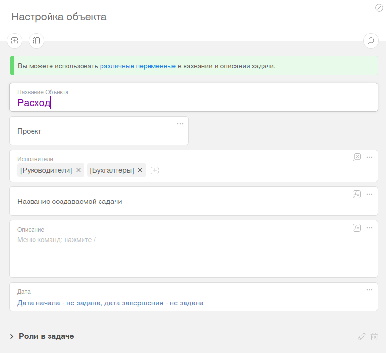
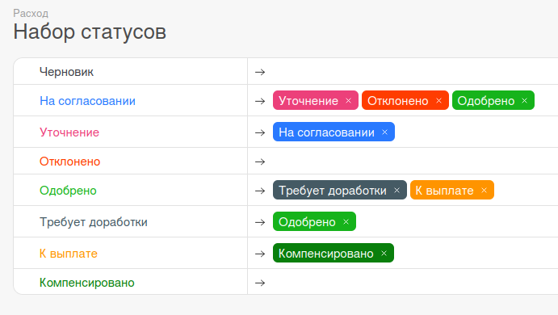
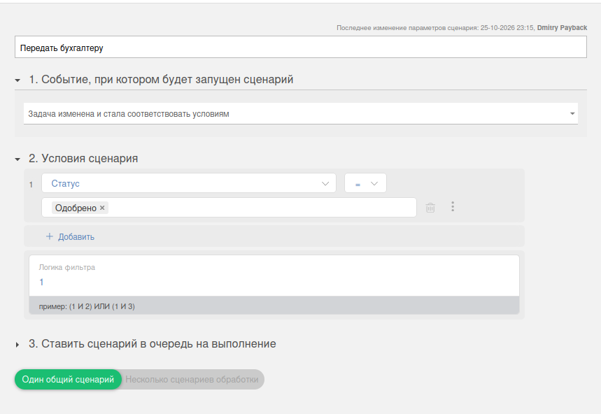
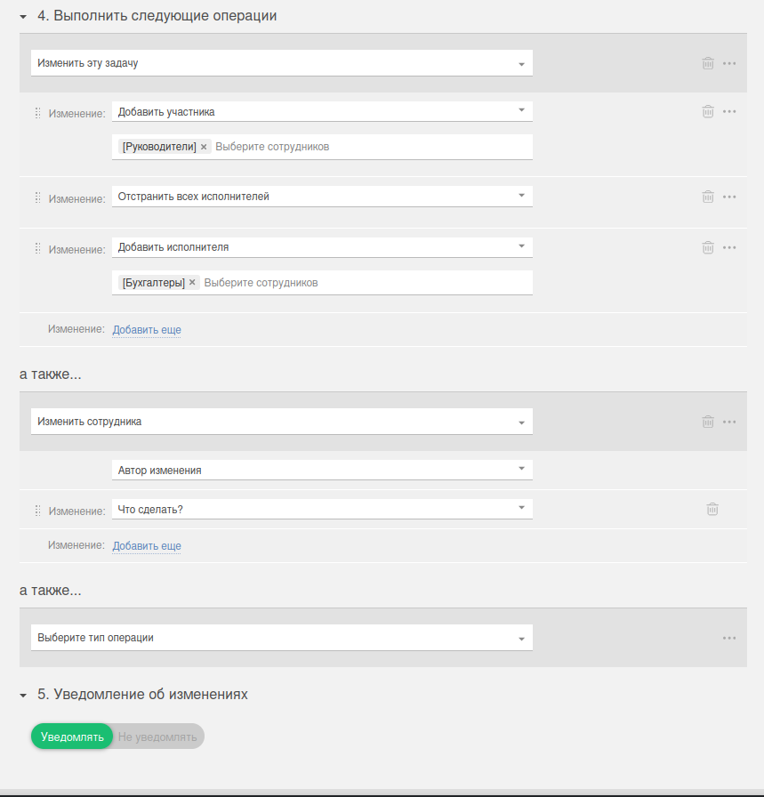
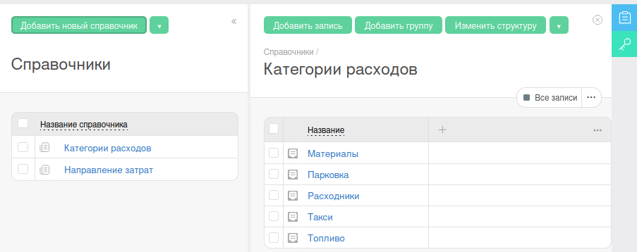
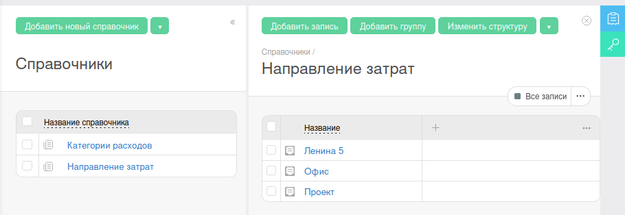

# Настройка PlanFix для клиента (Payback)

Эта инструкция выполняется один раз администратором аккаунта PlanFix.

## Что подготовить заранее

- Адрес вашего сервиса, который доступен снаружи по HTTPS.
  Пример: `https://your-domain.ru`
- `WEBHOOK_SECRET` из `.env` вашего бота
- Список сотрудников, кто будет в группах:
  - **Руководители**
  - **Бухгалтеры**

## 1) Создайте объект "Расход"

Откройте PlanFix -> Типы объектов -> создать объект.

Рекомендуемые базовые параметры:

- Название объекта: `Расход`
- Исполнители по умолчанию: можно оставить пусто
- Проект: любой рабочий проект вашего аккаунта

## 2) Настройте карточку задачи объекта

Добавьте пользовательские поля:

- `Сотрудник` (строка)
- `Сумма` (число)
- `Дата покупки` (дата)
- `Категория расходов` (поле "запись справочника")
- `Направление затрат` (поле "запись справочника")
- `ФН`, `ФД`, `ФП` (строка)
- `Без кассового чека` (флажок)
- `Дата выплаты` (дата)

Важно:

- у поля **Дата покупки** выключите автозаполнение текущей датой;
- у поля **Категория** не включайте запрет повторов.

## 3) Настройте статусы и переходы

Создайте статусы:

1. На согласовании
2. Уточнение
3. Одобрено
4. Отклонено
5. Требует доработки
6. К выплате
7. Компенсировано

И переходы между ними как на скриншоте:

## 4) Создайте сценарий "Передать бухгалтеру"

### 4.1 Событие и условие

- Событие: **Задача изменена и стала соответствовать условиям**
- Условие: **Статус = Одобрено**

### 4.2 Операции

Добавьте действия по порядку:

1. Добавить участника -> группа **Руководители**
2. Отстранить всех исполнителей
3. Добавить исполнителя -> группа **Бухгалтеры**

## 5) Создайте вебхук-сценарии

Нужно создать сценарии вебхука для статусов:

- Одобрено
- Отклонено
- Уточнение
- Требует доработки
- Компенсировано

### 5.1 Событие и условие (пример для "Одобрено")

- Событие: **Задача изменена и стала соответствовать условиям**
- Условие: **Статус = Одобрено**

### 5.2 Операция HTTP-запроса

- Тип операции: **Послать HTTP-запрос**
- Метод: `POST`
- URL: `https://<ваш-домен>/webhooks/planfix`
- Тип: `application/json`
- Параметры:
  - `secret` = `<WEBHOOK_SECRET>`
  - `task` = `{{Задача.Номер}}`
  - `status` = `{{Задача.Статус}}`

> На скриншоте выше чувствительные данные (URL и secret) намеренно скрыты.

## 6) Проверьте справочник "Категории расходов"

- Справочник: **Категории расходов**
- Поле (колонка): **Название**
- Записи (пример): Материалы, Топливо, Такси, Расходники, Парковка

## 7) Проверьте справочник "Направления затрат"

- Справочник: **Направления затрат**
- Поле (колонка): **Название**
- Записи (пример): Ленина 5, Офис, Проект

## 8) Финальная проверка

После настройки:

1. Отправьте тестовую заявку из Telegram.
2. Проверьте, что при переходах статуса в PlanFix прилетает вебхук в бот.
3. Проверьте цепочку:
   На согласовании -> Одобрено -> К выплате -> Компенсировано.
