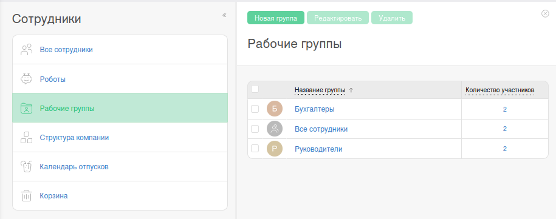
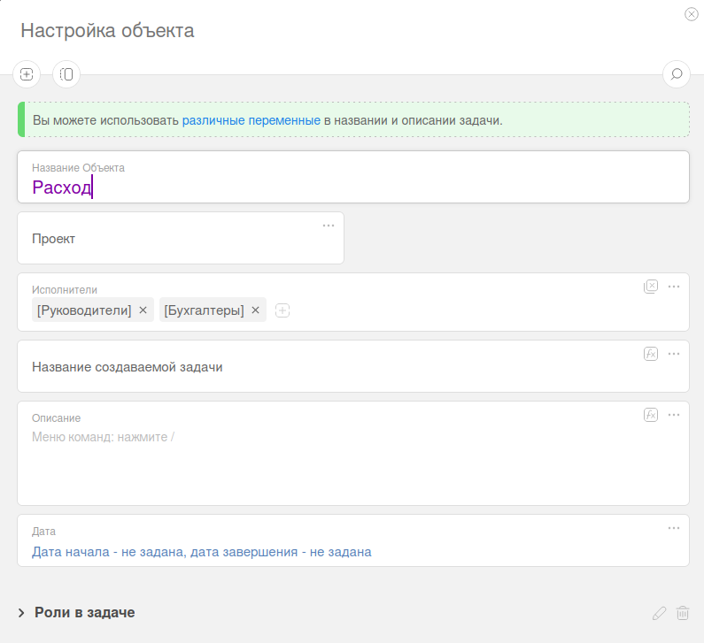
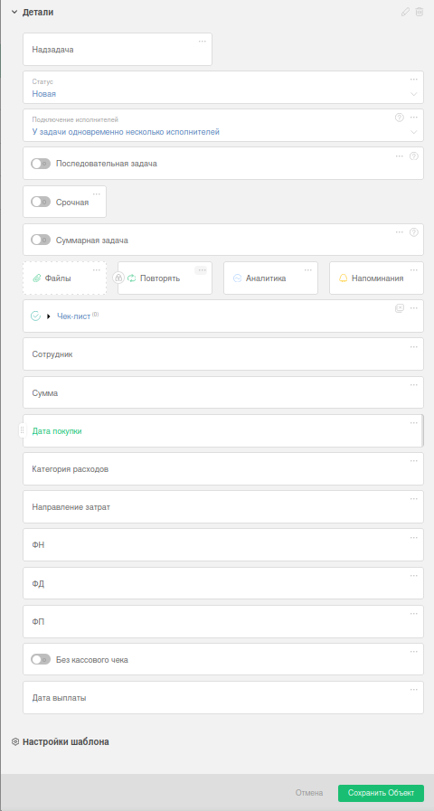
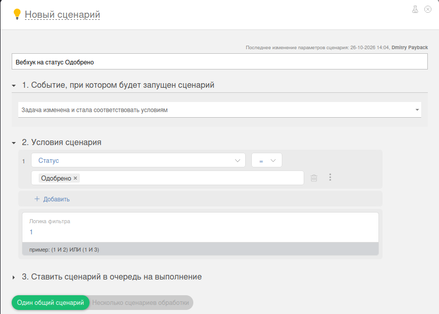
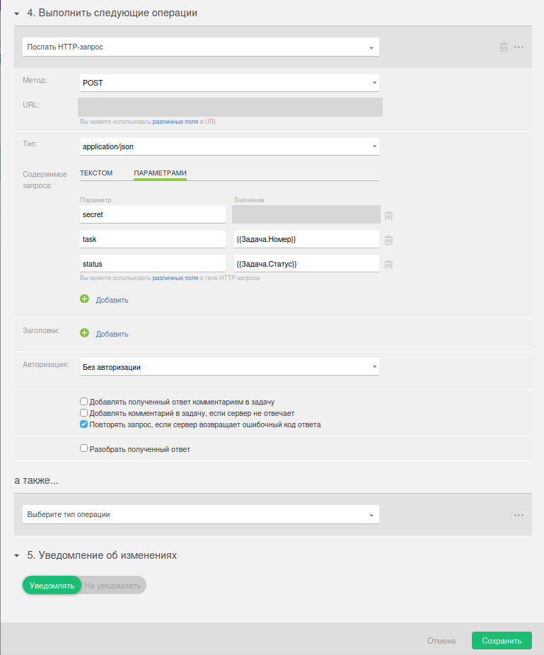

# PlanFix runbook (исполнитель)

Разовая настройка аккаунта клиента под бота Payback. **Делает исполнитель** при доступе админа PlanFix.

Ориентир: **Plan A**. Не использовать возможности выше Plan A (см. `planfix-notes.md`).

Порядок как в `spec.md` (раздел 7): робот → группы → справочники → объект (поля, статусы, сценарии) → ID в env.

## Перед стартом

Нужны: админ-доступ PlanFix, список людей и ролей, договорённость по домену. Публичный HTTPS endpoint вебхука и `WEBHOOK_SECRET` — из env бота (в доках не дублируем).

## 1) Робот и API-токен

Сотрудники → Роботы → «Новый робот» (например `Payback`). Робот бесплатен, прав администратора достаточно.

Управление аккаунтом → Доступ к API → REST API: выпустить токен **от имени робота**.

Уровни доступа токена: чтение / создание / изменение задач; чтение и добавление комментариев; добавление и чтение файлов; чтение сотрудников; чтение справочников.

Токен положить в env бота (`PLANFIX_ACCESS_TOKEN` / как в `.env.example`). Скрин в runbook не обязателен.

## 2) Рабочие группы

Сотрудники → Рабочие группы: создайте **Бухгалтеры** и **Руководители**, добавьте участников.

Включите «Отображать в списках выбора исполнителей и участников». «Разрешить контактам ставить задачи этой группе» — не включать.



Состав дальше ведёт клиент; сценарии объекта трогать не нужно.

## 3) Справочники

Создайте **до** полей объекта (поля «запись справочника» ссылаются на эти справочники).

**Категории расходов** — колонка «Название» (пример: Материалы, Топливо, Такси, …).


**Направления затрат** — колонка «Название» (пример: адрес / Офис / Проект).


## 4) Объект «Расход»

PlanFix → Типы объектов → создать объект.



- Название: `Расход`
- Исполнители по умолчанию: можно пусто
- Проект: любой рабочий проект аккаунта

## 5) Карточка задачи (поля)

- `Сотрудник` (строка)
- `Сумма` (число)
- `Дата покупки` (дата) — **без** автозаполнения текущей датой
- `Категория расходов` (запись справочника) — **без** запрета повторов
- `Направление затрат` (запись справочника)
- `ФН`, `ФД`, `ФП` (строка)
- `Без кассового чека` (флажок)
- `Дата выплаты` (дата)



## 6) Статусы и переходы

1. На согласовании  
2. Уточнение  
3. Одобрено  
4. Отклонено  
5. Требует доработки  
6. К выплате  
7. Компенсировано  

Начальный — «На согласовании». Переходы — как на скриншоте (права на смену статуса — по ролям процесса; ориентир — только «Исполнитель»).


## 7) Сценарий «Передать бухгалтеру»

**Событие:** задача изменена и стала соответствовать условиям  
**Условие:** статус = Одобрено  


**Операции по порядку:**

1. Добавить участника → **Руководители**
2. Отстранить всех исполнителей
3. Добавить исполнителя → **Бухгалтеры**


## 8) Вебхук-сценарии

Нужны отдельные сценарии (то же HTTP-тело) для статусов:

- Одобрено  
- Отклонено  
- Уточнение  
- Требует доработки  
- Компенсировано  

Ниже — **один** эталон («Одобрено»); остальные копируйте с другим условием статуса.

### 8.1 Условие (пример: Одобрено)



### 8.2 HTTP-запрос

- Операция: **Послать HTTP-запрос**
- Метод: `POST`
- URL: `https://<домен>/webhooks/planfix` (из договорённости / env)
- Тип: `application/json`
- Параметры:
  - `secret` = значение `WEBHOOK_SECRET`
  - `task` = `{{Задача.Номер}}`
  - `status` = `{{Задача.Статус}}`
- Авторизация: без авторизации (секрет в теле)
- Имеет смысл включить повтор при ошибочном ответе сервера



На скриншоте URL и secret скрыты намеренно.

## 9) ID в `.env` бота

В GUI PlanFix **нет** удобного места, откуда снять ID объекта и статусов для env.

После создания объекта и статусов:

```bash
make planfix-ids
```

Заполните `PLANFIX_OBJECT_ID`, `PLANFIX_STATUS_*`, `PLANFIX_FIELD_*` (и связанные) по выводу скрипта. Старт бота сверяет статусы со схемой — при рассинхроне не поднимется.

## 10) Проверка

Минимум: заявка из Telegram → одобрение → бухгалтер → «Компенсировано»; плюс отклонение / доработка с комментарием; вебхуки доходят до бота.
